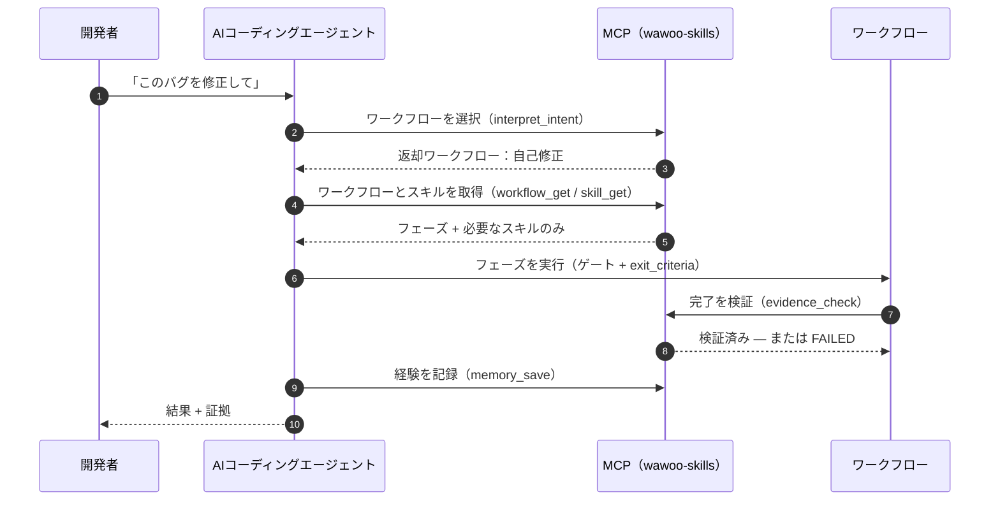

  

<h1 align="center">wawoo-skills</h1>

  <strong>AIコーディングエージェントは、なぜ必要なスキルを使わないのか？</strong>

  <a href="README.md">English</a> ·
  <a href="README.ja.md">日本語</a> ·
  <a href="README.zh-CN.md">简体中文</a> ·
  <a href="README.ko.md">한국어</a>

  <a href="docs/USAGE.ja.md">使用ガイド</a> ·
  <a href="https://github.com/parkwoo/wawoo-skills">GitHub</a>

**スキルもルールも用意したのに、AIコーディングエージェントはなぜ従わないのか？**

スキル、ロール、コーディング規約をすべて揃えたにもかかわらず、エージェントが独自のやり方で進め、スキルを無視し、手順を守らず、いつの間にかレビューやテストを飛ばしてしまう——そんな経験はありませんか？同じタスクでも、今日と明日で成果物の品質が異なる。規約を細かくすればするほど、エージェントがそれを読んでいないことに気づかされます。

問題はエージェントの能力が低いことではありません。**「スキルを使わせる」仕組みがないこと**です。

wawoo-skillsが提供するのは、ただ一つ: **「いつ、どのスキルを使うか」を事前に決定する仕組み**です。エージェントに固定のレールを敷きます——最初に何を読むべきか、どのワークフローを実行すべきか、スキップできないゲートはどれか。これにより、同じ依頼は常に同じ手順をたどり、確認可能な証拠が残ります。

**まず厳選、それから構築。** コミュニティで最も人気のスキルとエージェントワークフローを総ざらいし、プログラミングに本当に必要な部分を抽出し、さらに改変・自作して、ひとつのカタログ、ひとつのルーター、ひと組のゲートにまとめます。

プロダクトや技術スタックに依存しません。導入後すぐに利用可能です: **98 スキル・21 ロール・12 ワークフロー**に加え、ローカルサービス（MCP）を提供します。Cursor、Kilo、OpenCode、Codex、Claude Code、Paseoで動作します。使い方は[**使用ガイド**](docs/USAGE.ja.md)をご覧ください。

## wawoo-skillsとは何か

一言で言えば: **エージェントの「思考プロセス」は変えません。持っているスキルを、毎回確実に使わせるだけです。**

例えるなら、エージェントへの**クリニカルパス**——必要な検査と記録は必ず残し、具体的な実行方法はエージェントの裁量に任せます。

## なぜwawoo-skillsが必要か

その違いは、この一枚の表で明らかです:

| | wawoo-skills 無し | wawoo-skills 有り |
|---|---|---|
| 同じバグ | 毎回異なるアプローチ | 常に同じ流れ: 再現 → 修正 → 証拠 |
| レビュー / 法務 / テスト | いつの間にかスキップされる | 読み取り専用ゲート、成果物必須 |
| コンテキスト | 全スキルを一度に詰め込む | まず目録、必要なものだけ取得 |
| チームの知見 | Wikiに活用されていない | エージェントが実際に活用する |

## wawoo-skillsはどう実現しているか

一言で言えば: **依頼からワークフローを選び、許可されたツールだけに絞り、そのフェーズを実行します——骨格は固定、経路は動的。** 具体的には次の5つです:

1.  **ワークフローを選ぶ**: 「明示的な `/name` → ローカル語彙 → 学習済みトリガー → モデル判定」の4段階で照合します（`interpret_intent`）。
2.  **ツールを固定する**: ワークフローが決まると、セッションゲートがそのワークフローが許可する MCP ツールだけを通します——監査系は読み取り専用で、実装フェーズはありません（`mcp_tools_allow` / `implement_allowed`）。
3.  **フェーズを実行する**: 10個の再利用可能なフェーズが12本のワークフローを構成し、各フェーズの「完了条件」はツールが実際に検証します（`exit_criteria` / `evidence_check`）。実行経路は証拠に基づいてその場で決まり——不要なステップを飛ばす、並べ替える、優先度や範囲を変える、独立したサブタスクを並行実行する、必要なら中止します（`steer_task`）。手作業の計画は不要です。
4.  **スキルを必要時に取得**: まず目録を示し、必要なものだけ取得します——トークンを節約し、「見えないから使わない」を防ぎます。
5.  **経験を記録**: 決定事項とつまずきを保存し、次回自動で読み込みます——最初から説明し直す必要はありません（`memory_save`）。

## 何が得られるか

仕組みに加えて、**12本の固定ワークフロー**と、いくつかの追加機能が手に入ります。

### 12本のワークフロー

*   **デリバリー**: `/delivery-lite`（小規模な変更、デフォルト）、`/feature-delivery`（機能一式）
*   **デザイン**: `/ui-delivery`（UI変更）、`/design-review`（読み取り専用のUIレビュー）
*   **レビュー**: `/self-review`（自己修正）、`/compliance-review`（法務 / プライバシー / セキュリティ）、`/release-review`（リリース一式）
*   **調査**: `/research`（調査 → 判断）
*   **計画**: `/sprint-plan`（スプリント）、`/status-report`（進捗）
*   **運用**: `/incident-response`（障害: 証拠 → 緩和 → 振り返り）
*   **プロセス**: `/self-improve`（振り返り → PDCA）

どのワークフローにも**フェーズ、ゲート、完了条件**が設定されています。**レビュー系は読み取り専用**です。個別の使い方は[使用ガイド §1.2](docs/USAGE.ja.md#s1-2)をご覧ください。

### その他の能力

上記の仕組みに加え、以下の機能も利用できます:

| 能力 | 一言で |
|---|---|
| **予測可能、かつ柔軟** | 1つの依頼 → 1つのワークフロー（例:「このバグを修正して」→ 自己修正）。フェーズと exit_criteria は固定だが、フェーズ内ではスキップ・並べ替え・範囲変更ができる。 |
| **トークン節約** | 何百ものスキルを一度に渡すのではなく、目録を見せて必要な分だけ取得します。長い会話はローカルで要約。コンテキストが減り、コストも削減されます。 |
| **セキュリティとコンプライアンス** | 読み取り専用のセキュリティ / プライバシー / 法務チェックを内蔵。外部に送信する前に、機微情報、秘密、内部アドレスを自動で伏せることができます。 |
| **性能とチューニング** | まず速度とリソースを測定してから最適化。「体感で速くなった」は認めません。 |
| **サイズ制限** | 各スキルのエントリポイント`SKILL.md`は**2〜4KB**以内（超えると警告、詳細は`references/`へ）。説明は1行、約160文字。コンテキストが小さく、読み込みが速く、コストも低い。 |

## 対応クライアント

| ツール | 正式名 | Paseo provider | サポート | サイト / 備考 |
|---|---|---|---|---|
| Claude Code | Claude Code（Anthropic CLI） | `claude` | **対応** | MCP + `CLAUDE.md` · https://claude.com/claude-code |
| Codex | OpenAI Codex（CLI / VS Code 拡張） | `codex` | **対応** | MCP + `AGENTS.md` · https://developers.openai.com/codex |
| Cursor | Cursor | `cursor` | **部分対応** | スラッシュコマンド / エージェント切替なし · https://cursor.com |
| Kilo CLI | Kilo (CLI) | `kilo` | **対応** | 事前にKiloへログイン。設定は`~/.config/kilo` · https://kilo.ai |
| Kilo Code | Kilo Code（VS Code 拡張） | `kilo` | **対応** | VS Code拡張。事前にKiloへログイン · https://kilocode.ai |
| OpenCode | OpenCode | `opencode` | **対応** | 内蔵。同じ`opencode.json`（当方のagentsがmodesとして表示） · https://opencode.ai |
| Paseo | Paseo（マルチエージェントIDE） | — | **対応** | OpenCode内蔵 · https://github.com/getpaseo/paseo |
| Pi | Pi | `pi` | **部分対応** | サブエージェント拡張があれば並列、なければ順次（どちらも対応） |

**サポート水準**: **対応** = MCP + スキル / ワークフローが完全に動作。**部分対応** = 接続可能だが制約あり（備考参照）。

## 10分で始める

1.  AIコーディングエージェントに一言送り、返ってきた「どのワークフローか」を読みます。
2.  `/delivery-lite`を一度実行し、`docs/plans/ACTIVE.md`が1行進むのを確認（Kiloはスラッシュコマンド、CursorはMCP経由）。
3.  `python3 scripts/validate_assets.py`を実行し、`OK`が出れば導入成功。

インストールスクリプト、各クライアントの接続（Paseo / Codex含む）、トラブルシューティングは[**使用ガイド**](docs/USAGE.ja.md)をご覧ください。

## 能力一覧

**98 スキル・21 ロール・12 ワークフロー** — **プログラミング中心**で、記述、レビュー、テスト、リリースまでの開発フローをカバーします。

| 種別 | 数 | グループ |
|---|---|---|
| スキル | 98 | デリバリーと計画 13 · デバッグとテスト 5 · レビューと品質 6 · アーキテクチャと設計 7 · セキュリティとコンプラ 7 · デザインとフロント 14 · 調査とライティング 7 · 運用と性能 4 · 記憶とコンテキスト 6 · エンジニアリング原則 24 · プロセスと編成 5 |
| ロール | 21 | 入口 / デリバリー / レビュー / アーキテクチャ / デザイン / ドキュメント / 運用 |
| ワークフロー | 12 | デリバリー / デザイン / レビュー / 調査 / 計画 / 運用 / プロセス |

スキルの例: `diagnosing-bugs`、`security-review`、`memory`、`principle-fix-root-causes`。

完全な一覧（大分類 / 小分類 / 名前 / 説明）は`.kilo/CAPABILITIES.md`（機械可読）にあります。

## 用語

| 用語 | 一言で |
|---|---|
| AIコーディングエージェント（「エージェント」） | 日常的に使用するツール（Cursor / Kilo / OpenCode / Codex / Paseo）。wawoo-skillsはこれらに働きかけます。 |
| スキル skills | 再利用可能な手順書（`SKILL.md`）。例:「バグの診断方法」。 |
| ロール | wawoo-skills内で定義される「視点」。例: レビュアー / 実装者 / プロダクトオーナー。ワークフローが割り当てます。 |
| ワークフロー workflows | フェーズと完了条件を持つ手順。例: `/delivery-lite`。 |
| MCP | Model Context Protocol。外部ツールを接続するための規格。wawoo-skillsのMCPはPython標準ライブラリのみを使用します。 |
| ルーター（router） | ワークフローを自動で選択する機能。 |
| ゲート | 承認、証拠、失敗観察 — スキップできないチェックポイント。 |

## ライセンスと出典

**本リポジトリで作成された部分**（skills / agents / commands / MCP）は**MITライセンス**（`LICENSE`、Copyright (c) 2026 wawoo.jp）です。**第三者作品**も同梱しています — **ファイル単位の出典は`.kilo/skills/ATTRIBUTION.md`、ライセンス原文は`LICENSES/`および各スキルディレクトリ内の`LICENSE` / `LICENSE.txt` / `NOTICE.txt`**にあります。

| 出典 | 内容 | ライセンス | リンク（URL またはリポジトリ内パス） |
|---|---|---|---|
| Anthropic skills | `frontend-design` | Apache-2.0 | https://github.com/anthropics/skills · リポジトリ内 `.kilo/skills/frontend-design/LICENSE.txt` |
| garrytan/gstack | `design-review` | Apache-2.0 | https://github.com/garrytan/gstack · リポジトリ内 `.kilo/skills/design-review/LICENSE.txt` |
| Google Labs（`google-labs-code/skills`） | `design-md`（Stitch DESIGN.md 形式） | Apache-2.0 | https://github.com/google-labs-code/skills · リポジトリ内 `.kilo/skills/design-md/LICENSE.txt` |
| GoogleChrome/modern-web-guidance | `modern-web-guidance-bridge`（**ガイドは複製せず上流を参照**） | 上流に同じ | https://github.com/GoogleChrome/modern-web-guidance-src |
| Kilo built-in | 一部スキル（16） | MIT（`SKILL.md` frontmatter） | https://kilo.ai · 各 `SKILL.md` |
| Kilo Marketplace（Awesome Claude Skills の分岐） | agents: `frontend-specialist`、`docs-specialist`、`data`、`code-reviewer`、`code-skeptic`、`code-simplifier` | **Apache-2.0** | https://kilo.ai · リポジトリ内 `LICENSES/kilo-marketplace-*.txt` |
| Leonxlnx/taste-skill | `imagegen-frontend-mobile` | 上流に同じ | https://github.com/Leonxlnx/taste-skill · リポジトリ内 `.kilo/skills/imagegen-frontend-mobile/LICENSE` |
| OpenDesign と派生 | デザイン系: `design-brief`、`design-md`、`design-review`、`reference-design-contract`、`web-experience-design` など | **Apache-2.0** | https://open-design.ai · https://github.com/nexu-io/open-design · リポジポジトリ内 `LICENSES/open-design-Apache-2.0.txt` |
| pstack（Lauren Tan / Poteto） | `principle-*` と検証 / 思考系（37） | MIT | https://github.com/backnotprop/pstack · リポジトリ内 `LICENSES/pstack-MIT.txt` |
| Skills For Real Engineers（Matt Pocock） | エンジニアリング手順系（22） | MIT | https://github.com/mattpocock/skills · リポジトリ内 `LICENSES/skills-for-real-engineers-MIT.txt` |
| vercel-labs/web-interface-guidelines | `web-design-guidelines` の準拠根拠 | 上流に同じ | https://github.com/vercel-labs/web-interface-guidelines |
| wawoo（本リポジトリ） | skills / agents / commands / MCP | MIT | https://github.com/parkwoo/wawoo-skills · リポジトリ内 `LICENSE` |

*   **保証はありません（AS IS）**。
*   **ライセンス未確認の第三者資産は同梱しません** — 例: Marketplaceのビジネススキル3件（`license: NOASSERTION`）。
*   再配布・再利用の際は、**対応する著作権表示とNOTICEを保持**してください。

## 方法論の出典

公開されているエンジニアリング方法論から、実行可能な部分を抽出し、フローとして編成しています — **丸ごとコピーするのではなく、取捨選択して改変・編成し、出典を明記**しています。出典と項目ごとの対応については、技術記事（準備中）で詳しく解説します。

## バージョン

*   現在: **0.8.0**（`VERSION`）
*   変更履歴: `CHANGELOG.md`
