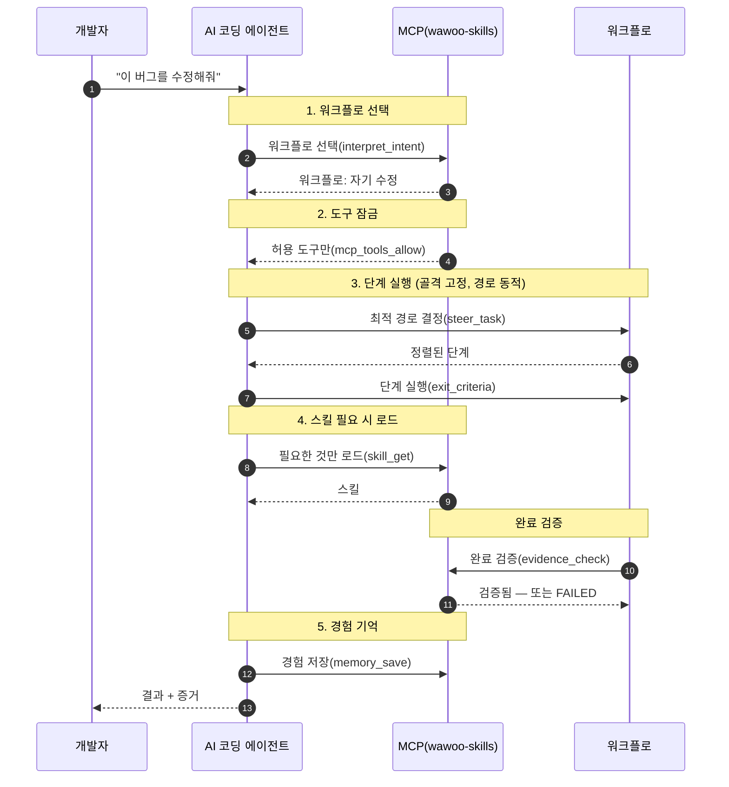

  

<h1 align="center">wawoo-skills</h1>

  <strong>AI 코딩 에이전트가 스킬을 가지고도 사용하지 않는 문제, 이제 해결합니다.</strong>

  <a href="README.md">English</a> ·
  <a href="README.ja.md">日本語</a> ·
  <a href="README.zh-CN.md">简体中文</a> ·
  <a href="README.ko.md">한국어</a>

  <a href="docs/USAGE.ko.md">사용 안내</a> ·
  <a href="https://github.com/parkwoo/wawoo-skills">GitHub</a>

**스킬, 역할, 코딩 규칙을 아무리 잘 정의해도 AI 코딩 에이전트는 여전히 이를 따르지 않습니다.**

에이전트는 스킬을 무시하고, 절차를 건너뛰며, 리뷰와 테스트 단계를 생략하는 일이 자주 발생합니다. 같은 작업을 요청해도 매번 다른 결과를 내놓습니다. 규칙을 더 상세하게 작성할수록, 에이전트가 이를 제대로 읽지 않는다는 사실만 더 명확해집니다.

문제는 에이전트의 지능이 부족해서가 아닙니다. **핵심은 "스킬을 사용하도록 강제하는 메커니즘"이 없다는 것입니다.**

wawoo-skills는 이 한 가지 문제에 집중합니다: **"언제 어떤 스킬을 사용할지"를 미리 결정합니다.** 에이전트에게 고정된 레일을 깔아주는 셈입니다. 무엇을 먼저 읽고, 어떤 워크플로를 실행하며, 건너뛸 수 없는 필수 게이트는 무엇인지 명확히 합니다. 그 결과, 동일한 요청은 항상 동일한 단계를 거치고, 검증 가능한 증거를 남깁니다.

**먼저 선별하고, 다음에 구축.** 커뮤니티에서 가장 인기 있는 스킬과 에이전트 워크플로를 훑어, 프로그래밍에 정말 필요한 부분을 추출하고, 각색하거나 직접 작성해, 하나의 카탈로그, 하나의 라우터, 하나의 게이트 세트로 통합합니다.

wawoo-skills는 제품이나 기술 스택에 구애받지 않습니다. 설치 즉시 사용할 수 있습니다: **98개 스킬 · 21개 역할 · 12개 워크플로**와 로컬 서비스(MCP)를 제공합니다. Cursor, Kilo, OpenCode, Codex, Claude Code, Paseo 등 다양한 에이전트에서 작동합니다. 자세한 사용법은 [**사용 안내**](docs/USAGE.ko.md)를 참조하세요.

## wawoo-skills란 무엇인가

한 줄 요약: **에이전트의 "사고 방식"을 바꾸는 것이 아니라, 이미 가진 스킬을 매번 올바르게 사용하도록 만듭니다.**

비유하자면, 에이전트에게 **임상 경로**를 제공하는 것과 같습니다. 필요한 검사와 기록을 하나도 빠뜨리지 않으면서도, 실제 작업 방식은 에이전트의 재량에 맡깁니다.

## 왜 wawoo-skills가 필요한가

다음 표 하나로 그 차이를 명확히 알 수 있습니다:

| | wawoo-skills 없음 | wawoo-skills 있음 |
|---|---|---|
| 같은 버그 | 매번 다른 해결 경로 | 일관된 흐름: 재현 → 수정 → 증거를 확보 |
| 리뷰 / 법무 / 테스트 | 누락되기 쉬움 | 읽기 전용 게이트, 필수 산출물 요구 |
| 컨텍스트 | 모든 스킬을 한꺼번에 제공 | 목록 먼저 제시, 필요한 스킬만 로드 |
| 팀 지식 | 위키에 잠들어 있음 | 에이전트가 실제로 활용 |

## wawoo-skills는 어떻게 구현하나

한 줄 요약: **요청에서 워크플로를 고르고, 허용된 도구만 잠그고, 그 단계를 실행합니다——골격은 고정, 경로는 동적.** 다음 다섯 가지로 구성됩니다:

1.  **워크플로 선택**: 「명시적 `/name` → 로컬 키워드 → 학습된 트리거 → 모델 판단」 네 단계로 매칭합니다(`interpret_intent`).
2.  **도구 잠금**: 워크플로가 정해지면 세션 게이트가 그 워크플로가 허용한 MCP 도구만 통과시킵니다——감사 계열은 읽기 전용이며 구현 단계가 없습니다(`mcp_tools_allow` / `implement_allowed`).
3.  **단계 실행**: 재사용 가능한 10개 단계가 12개 워크플로를 구성하고, 각 단계의 "완료 기준"은 도구가 실제로 검증합니다(`exit_criteria` / `evidence_check`). 실행 경로는 증거에 따라 실시간으로 정해집니다——불필요한 단계 건너뛰기, 재정렬, 우선순위·범위 변경, 독립 하위 작업 병렬 실행, 필요 시 중단(`steer_task`). 수동 계획은 필요 없습니다.
4.  **스킬 필요 시 로드**: 목록을 먼저 보여주고 필요한 것만 가져옵니다——토큰을 아끼고 "보이지 않아 안 쓰는" 문제를 막습니다.
5.  **경험 기억**: 결정과 함정을 저장해 다음 세션에 자동으로 불러옵니다——처음부터 다시 설명할 필요가 없습니다(`memory_save`).

## 무엇을 얻나

메커니즘 외에도 **12개의 고정 워크플로**와 몇 가지 추가 기능을 얻을 수 있습니다.

### 12개 워크플로

-   **딜리버리**: `/delivery-lite`(작은 변경, 기본), `/feature-delivery`(기능 전체)
-   **디자인**: `/ui-delivery`(UI 변경), `/design-review`(읽기 전용 UI 리뷰)
-   **리뷰**: `/self-review`(자기 수정), `/compliance-review`(법무 / 개인정보 / 보안), `/release-review`(릴리스 패키지)
-   **조사**: `/research`(조사 → 결정)
-   **계획**: `/sprint-plan`(스프린트), `/status-report`(진행)
-   **운영**: `/incident-response`(장애: 증거 → 완화 → 회고)
-   **프로세스**: `/self-improve`(회고 → PDCA)

모든 워크플로에는 **단계, 게이트, 완료 조건**이 명확히 정의되어 있습니다. **검토 계열은 읽기 전용**입니다. 개별 사용법은 [사용 안내 §1.2](docs/USAGE.ko.md#s1-2)를 참조하세요.

### 그 밖의 능력

위 메커니즘 외에도 다음 능력을 제공합니다:

| 능력 | 한 줄 설명 |
|---|---|
| **예측 가능하되 유연** | 하나의 요청 → 하나의 워크플로(예: "이 버그를 수정해줘" → 자기 수정). 단계와 exit_criteria는 고정이지만, 단계 안에서는 건너뛰기·재정렬·범위 축소가 가능합니다. |
| **토큰 절약** | 수백 개의 스킬을 한꺼번에 제공하는 대신, 목록을 보여준 뒤 필요한 만큼만 로드합니다. 긴 대화는 로컬에서 요약하여 컨텍스트를 줄이고 비용을 낮춥니다. |
| **보안과 컴플라이언스** | 읽기 전용 보안 / 개인정보 / 법무 점검 기능이 내장되어 있습니다. 외부로 보내기 전에 민감 정보, 비밀, 내부 주소를 가릴 수 있습니다. |
| **성능과 튜닝** | 먼저 속도와 자원을 측정한 뒤 최적화를 진행합니다. "체감상 빨라졌다"는 주장은 인정하지 않습니다. |
| **크기 제한** | 각 스킬의 진입 파일 `SKILL.md`는 **2–4KB** 이내로 유지됩니다(초과 시 경고, 상세 내용은 `references/` 참조). 설명은 한 줄, 약 160자 이내로 작성됩니다. 이는 컨텍스트를 작게 유지하고, 로딩 속도를 높이며, 비용을 낮춥니다. |

## 지원 클라이언트

| 도구 | 공식 이름 | Paseo provider | 지원 | 사이트 / 비고 |
|---|---|---|---|---|
| Claude Code | Claude Code(Anthropic CLI) | `claude` | **지원** | MCP + `CLAUDE.md` · https://claude.com/claude-code |
| Codex | OpenAI Codex(CLI / VS Code 확장) | `codex` | **지원** | MCP + `AGENTS.md` · https://developers.openai.com/codex |
| Cursor | Cursor | `cursor` | **부분 지원** | 슬래시 명령 / 에이전트 전환 없음 · https://cursor.com |
| Kilo CLI | Kilo (CLI) | `kilo` | **지원** | 먼저 Kilo에 로그인. 설정은 `~/.config/kilo` · https://kilo.ai |
| Kilo Code | Kilo Code(VS Code 확장) | `kilo` | **지원** | VS Code 확장. 먼저 Kilo에 로그인 · https://kilocode.ai |
| OpenCode | OpenCode | `opencode` | **지원** | 내장. 같은 `opencode.json`(우리 agents가 modes로 표시됨) · https://opencode.ai |
| Paseo | Paseo(멀티 에이전트 IDE) | — | **지원** | OpenCode 내장 · https://github.com/getpaseo/paseo |
| Pi | Pi | `pi` | **부분 지원** | 서브에이전트 확장이 있으면 병렬, 없으면 순차(둘 다 지원) |

**지원 수준**: **지원** = MCP + 스킬 / 워크플로가 완전히 동작. **부분 지원** = 연결되지만 제약이 있음(비고 참조).

## 10분 시작

1.  AI 코딩 에이전트에 메시지를 보내고, 에이전트가 반환하는 "어떤 워크플로인지"를 확인합니다.
2.  `/delivery-lite`를 한 번 실행하고, `docs/plans/ACTIVE.md` 파일이 한 줄 진행되는지 확인합니다(Kilo는 슬래시 명령, Cursor는 MCP 경유).
3.  `python3 scripts/validate_assets.py`를 실행하여 `OK`가 출력되면 설치가 성공한 것입니다.

설치 스크립트, 클라이언트별 연결(Paseo / Codex 포함), 트러블슈팅에 대한 자세한 내용은 [**사용 안내**](docs/USAGE.ko.md)를 참조하세요.

## 기능 목록

**98개 스킬 · 21개 역할 · 12개 워크플로** — **프로그래밍 중심**으로, 작성·리뷰·테스트·릴리스까지 개발 흐름 전반을 아우릅니다.

| 종류 | 수 | 그룹 |
|---|---|---|
| 스킬 | 98 | 딜리버리와 계획 13 · 디버깅과 테스트 5 · 리뷰와 품질 6 · 아키텍처와 설계 7 · 보안과 컴플라이언스 7 · 디자인과 프런트엔드 14 · 조사와 글쓰기 7 · 운영과 성능 4 · 기억과 컨텍스트 6 · 엔지니어링 원칙 24 · 프로세스와 오케스트레이션 5 |
| 역할 | 21 | 진입 / 딜리버리 / 리뷰 / 아키텍처 / 디자인 / 문서 / 운영 |
| 워크플로 | 12 | 딜리버리 / 디자인 / 리뷰 / 조사 / 계획 / 운영 / 프로세스 |

스킬 예시: `diagnosing-bugs`, `security-review`, `memory`, `principle-fix-root-causes`.

전체 목록(대분류 / 소분류 / 이름 / 설명): `.kilo/CAPABILITIES.md`(기계 판독 가능).

## 용어

| 용어 | 한 줄 설명 |
|---|---|
| AI 코딩 에이전트("에이전트") | 일상적으로 사용하는 도구(Cursor / Kilo / OpenCode / Codex / Paseo). wawoo-skills는 이러한 도구와 연동됩니다. |
| 스킬 skills | 재사용 가능한 절차서(`SKILL.md`). 예: "버그 진단하는 법" |
| 역할 | wawoo-skills 내에서 정의하는 "관점". 예: 리뷰어 / 구현자 / 제품 책임자. 워크플로가 배정합니다. |
| 워크플로 workflows | 단계와 완료 조건을 가진 절차. 예: `/delivery-lite` |
| MCP | Model Context Protocol. 외부 도구를 연결하는 규격. wawoo-skills의 MCP는 파이썬 표준 라이브러리만 사용합니다. |
| 라우터(router) | 워크플로를 자동으로 선택하는 기능. |
| 게이트 | 승인·증거·실패 관찰 등 건너뛸 수 없는 체크포인트. |

## 라이선스와 출처

**이 저장소가 작성한 부분**(skills / agents / commands / MCP)은 **MIT**(`LICENSE`, Copyright (c) 2026 wawoo.jp) 라이선스를 따릅니다. **제3자 저작물**도 함께 포함하며, **파일별 출처는 `.kilo/skills/ATTRIBUTION.md`, 라이선스 원문은 `LICENSES/`와 각 스킬 디렉터리의 `LICENSE` / `LICENSE.txt` / `NOTICE.txt`**에서 확인할 수 있습니다.

| 출처 | 내용 | 라이선스 | 링크(URL 또는 저장소 내 경로) |
|---|---|---|---|
| Anthropic skills | `frontend-design` | Apache-2.0 | https://github.com/anthropics/skills · 저장소 내 `.kilo/skills/frontend-design/LICENSE.txt` |
| garrytan/gstack | `design-review` | Apache-2.0 | https://github.com/garrytan/gstack · 저장소 내 `.kilo/skills/design-review/LICENSE.txt` |
| Google Labs(`google-labs-code/skills`) | `design-md`(Stitch DESIGN.md 형식) | Apache-2.0 | https://github.com/google-labs-code/skills · 저장소 내 `.kilo/skills/design-md/LICENSE.txt` |
| GoogleChrome/modern-web-guidance | `modern-web-guidance-bridge`(**가이드 복제하지 않음, 업스트림 참조**) | 업스트림과 동일 | https://github.com/GoogleChrome/modern-web-guidance-src |
| Kilo built-in | 일부 스킬(16) | MIT(`SKILL.md` frontmatter) | https://kilo.ai · 각 `SKILL.md` |
| Kilo Marketplace(Awesome Claude Skills 분기) | agents: `frontend-specialist`, `docs-specialist`, `data`, `code-reviewer`, `code-skeptic`, `code-simplifier` | **Apache-2.0** | https://kilo.ai · 저장소 내 `LICENSES/kilo-marketplace-*.txt` |
| Leonxlnx/taste-skill | `imagegen-frontend-mobile` | 업스트림과 동일 | https://github.com/Leonxlnx/taste-skill · 저장소 내 `.kilo/skills/imagegen-frontend-mobile/LICENSE` |
| OpenDesign 및 파생 | 디자인 계열: `design-brief`, `design-md`, `design-review`, `reference-design-contract`, `web-experience-design` 등 | **Apache-2.0** | https://open-design.ai · https://github.com/nexu-io/open-design · 저장소 내 `LICENSES/open-design-Apache-2.0.txt` |
| pstack(Lauren Tan / Poteto) | `principle-*` 및 검증 / 사고 계열(37) | MIT | https://github.com/backnotprop/pstack · 저장소 내 `LICENSES/pstack-MIT.txt` |
| Skills For Real Engineers(Matt Pocock) | 엔지니어링 절차 계열(22) | MIT | https://github.com/mattpocock/skills · 저장소 내 `LICENSES/skills-for-real-engineers-MIT.txt` |
| vercel-labs/web-interface-guidelines | `web-design-guidelines` 준거 | 업스트림과 동일 | https://github.com/vercel-labs/web-interface-guidelines |
| wawoo(이 저장소) | skills / agents / commands / MCP | MIT | https://github.com/parkwoo/wawoo-skills · 저장소 내 `LICENSE` |

-   **어떠한 보증도 하지 않습니다(AS IS)**.
-   **라이선스 미확인 제3자 자산은 동봉하지 않습니다** — 예: Marketplace의 business 스킬 3종(`license: NOASSERTION`).
-   재배포·재사용 시 **해당 저작권 표시와 NOTICE를 유지**해야 합니다.

## 방법론 출처

공개된 엔지니어링 방법론에서 실행 가능한 부분을 선별하여 흐름으로 연결합니다 — **그대로 복제하지 않고, 취사선택해 각색·편성하고 출처를 명시합니다**. 출처와 항목별 대응 관계는 기술 문서(준비 중)에서 확인할 수 있습니다.

## 버전

-   현재: **0.8.0**(`VERSION`)
-   변경 이력: `CHANGELOG.md`
