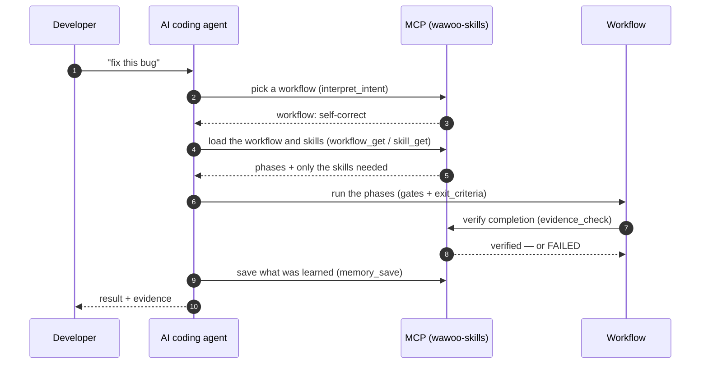

<p align="center">
  
</p>

<h1 align="center">wawoo-skills</h1>

<p align="center">
  <strong>Your AI coding agent has the skills. It just doesn't use them.</strong>
</p>

<p align="center">
  <a href="https://github.com/parkwoo/wawoo-skills/stargazers"></a>
  <a href="LICENSE"></a>
  <a href="https://github.com/parkwoo/wawoo-skills/releases"></a>
  <a href="docs/USAGE.md"></a>
  <a href="mcp/server.py"></a>
</p>

<p align="center">
  <a href="README.md">English</a> ·
  <a href="README.ja.md">日本語</a> ·
  <a href="README.zh-CN.md">简体中文</a> ·
  <a href="README.ko.md">한국어</a>
</p>

<p align="center">
  <a href="docs/USAGE.md">Usage</a> ·
  <a href="https://github.com/parkwoo/wawoo-skills">GitHub</a>
</p>

**You've defined skills, agent roles, and coding rules. Your AI coding agent still ignores them.**

Ever set up an agent with specific skills, roles, and coding guidelines, only to watch it improvise—bypassing skills, ignoring workflows, and quietly skipping reviews and tests? The same task yields different results daily. The more detailed your rules, the more apparent it becomes that the agent simply isn't reading them.

The problem isn't a lack of intelligence. It's that **nothing compels it to use its capabilities.**

wawoo-skills does one thing: **it dictates *which* skill to use, and *when*.** It establishes a fixed path for the agent—what to read first, which workflow to execute, and which gates cannot be bypassed. This ensures that the same request follows the same steps every time, leaving verifiable evidence.

**Curated first, then built.** We sift the most popular community skills and agent workflows, extract what programming truly needs, then adapt or create it—into one catalog, one router, and one set of gates.

It's product and stack-agnostic—install and go: **98 skills, 21 agent roles, 12 workflows**, plus a local service (MCP). Works with Cursor, Kilo, OpenCode, Codex, Claude Code, Paseo. See [**Usage**](docs/USAGE.md).

### Install in 30 seconds

```bash
git clone https://github.com/parkwoo/wawoo-skills
cd wawoo-skills
python3 scripts/install_global.py     # Kilo (global).  OpenCode / Cursor / Codex / Claude Code: see Usage
```

Then ask your agent to *"fix this bug"* and watch it pick a workflow, fetch only the skills it needs, and refuse to call it done without evidence. Per-client setup → [**Usage**](docs/USAGE.md) · steps → [Quick start](#quick-start-10-minutes).

## What wawoo-skills is

In short: **it doesn't change *how* the agent thinks—it just ensures it *actually uses* the skills it possesses.**

Think of it as a **clinical pathway**: every required check is performed and recorded, while the agent retains autonomy over *how* the work is performed.

## Why you need wawoo-skills

The difference is clear in this table:

| | Without wawoo-skills | With wawoo-skills |
|---|---|---|
| The same bug | A different path every time | A consistent chain: reproduce → fix → evidence |
| Review / legal / tests | Quietly skipped | Read-only gates; artifacts required |
| Context | Loading all skills into context | Catalog first, fetch only what's needed |
| Team knowledge | Isolated in a wiki | Actively utilized by the agent |

## How wawoo-skills works

In one line: **pick the workflow from the request, lock down the tools it allows, then run its phases.** Five key components:

1.  **Pick the workflow**: match the request in four steps—explicit `/name` → local keywords → learned triggers → model judgment (`interpret_intent`).
2.  **Lock the tools**: once a workflow is chosen, a session gate allows only the MCP tools that workflow lists—audit workflows get read-only tools and no implement phase (`mcp_tools_allow`, `implement_allowed`).
3.  **Run the phases**: 10 reusable phases compose 12 workflows; each phase has a definition of done that a tool actually checks, not the model's self-report (`exit_criteria`, `evidence_check`).
4.  **Fetch skills on demand**: show the catalog first, fetch only what's needed—saves tokens and avoids "invisible, so unused."
5.  **Remember what was learned**: save decisions and pitfalls, load them next session—no re-explaining from scratch (`memory_save`).



## What you get

Beyond the core mechanism, you gain **12 fixed workflows** plus additional capabilities.

### 12 workflows

*   **Delivery**: `/delivery-lite` (small change, default), `/feature-delivery` (full feature)
*   **Design**: `/ui-delivery` (change UI), `/design-review` (read-only UI review)
*   **Review**: `/self-review` (self-correction), `/compliance-review` (legal / privacy / security), `/release-review` (release package)
*   **Research**: `/research` (research → decision)
*   **Planning**: `/sprint-plan` (sprint), `/status-report` (progress)
*   **Ops**: `/incident-response` (incident: evidence → mitigate → review)
*   **Process**: `/self-improve` (retro → PDCA)

Every workflow includes **phases, gates, and exit criteria**; **audit workflows are restricted to read-only operations**. For per-workflow usage, see [Usage §1.2](docs/USAGE.md#s1-2).

### More capabilities

Beyond the mechanism described above, it also:

| Capability | In one line |
|---|---|
| **Predictable, still flexible** | One request → one workflow (e.g. "fix this bug" → self-correct); phases and exit criteria are fixed, but inside a phase the agent can skip, reorder, or narrow scope. |
| **Saves tokens** | Instead of dumping hundreds of skills at once, it presents a catalog and fetches only what's needed. It can also shorten long chats locally. Less context, lower cost. |
| **Security & compliance** | Built-in read-only security, privacy, and legal checks. Before content leaves for an external service, it can mask sensitive data, secrets, and internal addresses. |
| **Performance & tuning** | Measures speed and resources *before* tuning—performance claims must be validated |
| **Size limits** | Each skill entry `SKILL.md` stays within **2–4KB** (over 4KB triggers a warning; details go to `references/`). Descriptions are one line, about 160 characters. Small context, fast loading, lower cost. |

## Supported clients

| Tool | Official name | Paseo provider | Support | Site / notes |
|---|---|---|---|---|
| Claude Code | Claude Code (Anthropic CLI) | `claude` | **Supported** | MCP + `CLAUDE.md` · https://claude.com/claude-code |
| Codex | OpenAI Codex (CLI / VS Code extension) | `codex` | **Supported** | MCP + `AGENTS.md` · https://developers.openai.com/codex |
| Cursor | Cursor | `cursor` | **Partial** | No slash commands / agent switching · https://cursor.com |
| Kilo CLI | Kilo (CLI) | `kilo` | **Supported** | Sign in to Kilo first; config in `~/.config/kilo` · https://kilo.ai |
| Kilo Code | Kilo Code (VS Code extension) | `kilo` | **Supported** | VS Code extension; sign in to Kilo first · https://kilocode.ai |
| OpenCode | OpenCode | `opencode` | **Supported** | Built-in; same `opencode.json` (our agents appear as modes) · https://opencode.ai |
| Paseo | Paseo (multi-agent IDE) | — | **Supported** | Built-in OpenCode · https://github.com/getpaseo/paseo |
| Pi | Pi | `pi` | **Partial** | Parallel with a subagent extension; sequential without one (both supported) |

**Support levels**: **Supported** = MCP + skills / workflows run fully; **Partial** = it connects, with constraints (noted).

## Quick start (10 minutes)

1.  Say one sentence to your AI coding agent; read the workflow it returns.
2.  Run `/delivery-lite` once; observe `docs/plans/ACTIVE.md` advance a row (Kilo uses slash commands; Cursor goes through MCP).
3.  Run `python3 scripts/validate_assets.py`; `OK` confirms your setup.

Installation scripts, per-client setup (including Paseo / Codex), and troubleshooting: [**Usage**](docs/USAGE.md).

## Capabilities at a glance

**98 skills, 21 agent roles, 12 workflows**—**primarily programming**, covering the development flow from writing to review, testing, and release.

| Type | Count | Groups |
|---|---|---|
| Skills | 98 | Delivery & planning 13 · Debugging & testing 5 · Review & quality 6 · Architecture & code design 7 · Security & compliance 7 · Design & frontend 14 · Research & writing 7 · Ops & performance 4 · Memory & context 6 · Engineering principles 24 · Process & orchestration 5 |
| Agent roles | 21 | Entry / Delivery / Review / Architecture / Design / Docs / Ops |
| Workflows | 12 | Delivery / Design / Review / Research / Planning / Ops / Process |

Skill examples: `diagnosing-bugs`, `security-review`, `memory`, `principle-fix-root-causes`.

Full list (group / subgroup / name / description): `.kilo/CAPABILITIES.md` (machine-readable).

## Glossary

| Term | In one line |
|---|---|
| AI coding agent (the "agent") | The tool you use daily (Cursor / Kilo / OpenCode / Codex / Paseo); wawoo-skills acts upon it |
| Skill | A reusable instruction file (`SKILL.md`), e.g., "how to diagnose a bug" |
| Agent role | A viewpoint defined in wawoo-skills, e.g., reviewer / implementer / product owner; scheduled by workflows |
| Workflow | An ordered process with phases and a definition of done, e.g., `/delivery-lite` |
| MCP | Model Context Protocol, a method for connecting external tools; our MCP server uses only the Python standard library |
| Router | Automatically selects a workflow for you |
| Gate | A mandatory checkpoint—approval, evidence, observed failure—that cannot be skipped |

## License & sources

The components **developed for wawoo-skills** (skills / agents / commands / MCP) are **MIT** (`LICENSE`, Copyright (c) 2026 wawoo.jp). wawoo-skills also bundles **third-party work**—**per-file provenance is in `.kilo/skills/ATTRIBUTION.md`; full license texts are in `LICENSES/` and each skill's `LICENSE` / `LICENSE.txt` / `NOTICE.txt`**.

| Source | Content | License | Link (URL or in-repo path) |
|---|---|---|---|
| Anthropic skills | `frontend-design` | Apache-2.0 | https://github.com/anthropics/skills · in-repo `.kilo/skills/frontend-design/LICENSE.txt` |
| garrytan/gstack | `design-review` | Apache-2.0 | https://github.com/garrytan/gstack · in-repo `.kilo/skills/design-review/LICENSE.txt` |
| Google Labs (`google-labs-code/skills`) | `design-md` (Stitch DESIGN.md format) | Apache-2.0 | https://github.com/google-labs-code/skills · in-repo `.kilo/skills/design-md/LICENSE.txt` |
| GoogleChrome/modern-web-guidance | `modern-web-guidance-bridge` (**no copied guides—upstream on demand**) | see upstream | https://github.com/GoogleChrome/modern-web-guidance-src |
| Kilo built-in | Some skills (16) | MIT (`SKILL.md` frontmatter) | https://kilo.ai · each `SKILL.md` |
| Kilo Marketplace (fork of Awesome Claude Skills) | Agents: `frontend-specialist`, `docs-specialist`, `data`, `code-reviewer`, `code-skeptic`, `code-simplifier` | **Apache-2.0** | https://kilo.ai · in-repo `LICENSES/kilo-marketplace-*.txt` |
| Leonxlnx/taste-skill | `imagegen-frontend-mobile` | see upstream | https://github.com/Leonxlnx/taste-skill · in-repo `.kilo/skills/imagegen-frontend-mobile/LICENSE` |
| OpenDesign and derivatives | Design skills: `design-brief`, `design-md`, `design-review`, `reference-design-contract`, `web-experience-design`, … | **Apache-2.0** | https://open-design.ai · https://github.com/nexu-io/open-design · in-repo `LICENSES/open-design-Apache-2.0.txt` |
| pstack (Lauren Tan / Poteto) | `principle-*` and verification / thinking skills (37) | MIT | https://github.com/backnotprop/pstack · in-repo `LICENSES/pstack-MIT.txt` |
| Skills For Real Engineers (Matt Pocock) | Engineering-workflow skills (22) | MIT | https://github.com/mattpocock/skills · in-repo `LICENSES/skills-for-real-engineers-MIT.txt` |
| vercel-labs/web-interface-guidelines | Basis for `web-design-guidelines` | see upstream | https://github.com/vercel-labs/web-interface-guidelines |
| wawoo (this repo) | skills / agents / commands / MCP | MIT | https://github.com/parkwoo/wawoo-skills · in-repo `LICENSE` |

*   **No warranty (AS IS).**
*   **Unverified-license third-party assets are not shipped**—e.g., the 3 Marketplace "business" skills (`license: NOASSERTION`).
*   When you redistribute or reuse any part, **retain the matching copyright and NOTICE**.

## Where the methodology comes from

wawoo-skills extracts executable components from public engineering methodologies and orchestrates them into structured workflows—**not copied, but reused**. Sources and per-item mapping are detailed in a technical article (in progress).

## Version

*   Current: **0.8.0** (`VERSION`)
*   Change history: `CHANGELOG.md`
