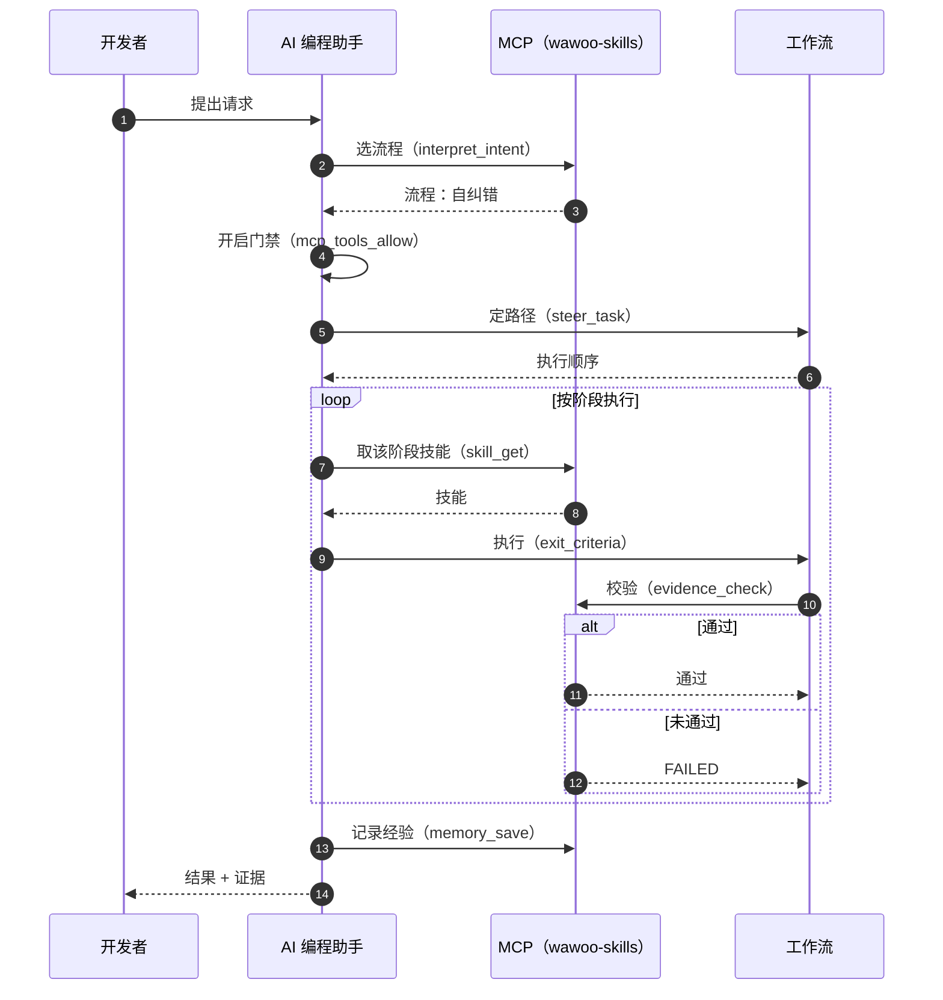

  

<h1 align="center">wawoo-skills</h1>

  <strong>你的 AI 编程助手，装了技能却不用。</strong>

  <a href="README.md">English</a> ·
  <a href="README.ja.md">日本語</a> ·
  <a href="README.zh-CN.md">简体中文</a> ·
  <a href="README.ko.md">한국어</a>

  <a href="docs/USAGE.zh-CN.md">使用说明</a> ·
  <a href="https://github.com/parkwoo/wawoo-skills">GitHub</a>

**技能写了，规范定了，AI 编程助手还是不照做。**

你有没有过这种感觉：技能库、角色、编码规范都写好了，AI 编程助手（简称「助手」）却还是想到哪写到哪——不查技能、不按流程，评审和测试悄悄跳过。同一个任务，今天一个样，明天又一个样；你越把规范写细，越发现它根本不读。

问题不在它笨，而在于**没有人规定它「必须去用」**。

wawoo-skills 只做一件事：**把「什么时候用哪个技能」提前定死。** 它给 AI 编程助手铺**一条固定的流程导轨**——先读什么、走哪条流程、哪些关卡不能跳过，全都定好。于是**同一个请求，每次走同样的步骤**，还留下可核对的证据。

**先精选，再打造。** 我们筛遍社区最火的 skills 与 agent 工作流，提取编程真正用得上的那部分，再改造、原创，收进同一套目录、同一个路由、同一组关卡。

wawoo-skills 不依赖你的产品和技术栈，装上就能用：**98 个技能、21 个角色、12 条工作流**，外加一个本地服务（MCP）。Cursor、Kilo、OpenCode、Codex、Claude Code、Paseo 都能用。安装和使用见 [**使用说明**](docs/USAGE.zh-CN.md)。

## wawoo-skills 是什么

一句话：**它不改 AI 编程助手「怎么想」，只保证它每次都真的去用该用的技能。**

打个比方：像给助手一条**临床路径**——该做的检查、该留的记录一个都不漏；至于怎么处理，助手照常发挥。

## 为什么需要 wawoo-skills

差别有多大，一张表就够：

| | 没有 wawoo-skills | 有了 wawoo-skills |
|---|---|---|
| 同一个 bug | 每次路径都不同 | 同一条链路：复现 → 修复 → 证据 |
| 评审 / 合规 / 测试 | 常被悄悄跳过 | 只读闸门，必须有产物 |
| 上下文 | 整份技能列表塞满 | 先给目录，再只取需要的一个 |
| 团队经验 | 停在 wiki 里 | 被助手真正调用 |

## wawoo-skills 是怎么做到的

核心一句话：**按请求选流程，锁住可用工具，再按阶段执行——骨架固定，路径动态。** 具体是五件事：

1. **选流程**：按「显式命令 → 本地关键词 → 已学习触发词 → 模型判断」四级依次匹配（`interpret_intent`）。
2. **锁工具**：流程选定后开启会话门禁，只放行该流程允许的 MCP 工具——审查类只用只读工具，也没有实现阶段（`mcp_tools_allow` / `implement_allowed`）。
3. **按阶段执行**：10 个可复用阶段拼出 12 条流程，每阶段的"完成标准"由工具实际校验（`exit_criteria` / `evidence_check`）；执行路径由系统按证据实时决定——跳过多余、重排、改优先级/范围、并行独立子任务、必要时中止（`steer_task`），不用手工规划。
4. **按需取技能**：先给目录，用到才取——省 token，也避免"看不见就不用"。
5. **记住经验**：把决定和踩过的坑存下来，下次自动加载，不用从头解释（`memory_save`）。

## 你能得到什么

机制之外，落到你手里的是 **12 条固定流程**，以及几项额外能力。

### 12 条工作流

- **交付**：`/delivery-lite`（小改动，默认）、`/feature-delivery`（完整功能）
- **设计**：`/ui-delivery`（改 UI）、`/design-review`（只读 UI 评审）
- **评审**：`/self-review`（自纠错）、`/compliance-review`（法务 / 隐私 / 安全）、`/release-review`（发布包）
- **调研**：`/research`（调研 → 决策）
- **计划**：`/sprint-plan`（迭代）、`/status-report`（进度）
- **运维**：`/incident-response`（故障：取证 → 缓解 → 复盘）
- **流程**：`/self-improve`（复盘 → PDCA）

每条工作流都有**阶段、闸门、完成条件**；**审查类只读**。逐条用法见 [使用说明 §1.2](docs/USAGE.zh-CN.md#s1-2)。

### 还有这些能力

除了上面这套机制，它还能：

| 能力 | 一句话说明 |
|---|---|
| **可预期，也灵活** | 一个请求 → 一条流程（如「修一下这个 bug」→ 自纠错）；阶段和 exit_criteria 固定，但阶段内部可以跳过、重排、改范围。 |
| **省 token** | 不把上百个技能一口气塞给助手，而是先给目录、要用再取；还能在本地把冗长对话压短。上下文用得少，费用也低。 |
| **安全与合规** | 内置只读的安全 / 隐私 / 法务检查；把内容发到外部之前，可自动给敏感信息、密钥、内部地址打码。 |
| **性能与优化** | 先把速度 / 资源量出来，再谈优化——不接受「感觉变快了」。 |
| **严格控大小** | 每个技能入口 `SKILL.md` 控制在 **2–4KB**（超 4KB 会 WARN，细节拆到 `references/`）；描述一行、约 160 字符。上下文小、加载快、费用低。 |

## 支持的客户端

| 工具 | 官方名称 | Paseo provider | 支持级别 | 官网 / 备注 |
|---|---|---|---|---|
| Claude Code | Claude Code（Anthropic CLI） | `claude` | **支持** | MCP + `CLAUDE.md` · https://claude.com/claude-code |
| Codex | OpenAI Codex（CLI / VS Code 扩展） | `codex` | **支持** | MCP + `AGENTS.md` · https://developers.openai.com/codex |
| Cursor | Cursor | `cursor` | **部分支持** | 无斜杠命令 / agent 切换 · https://cursor.com |
| Kilo CLI | Kilo (CLI) | `kilo` | **支持** | 先登录 Kilo；配置在 `~/.config/kilo` · https://kilo.ai |
| Kilo Code | Kilo Code（VS Code 扩展） | `kilo` | **支持** | VS Code 扩展；先登录 Kilo · https://kilocode.ai |
| OpenCode | OpenCode | `opencode` | **支持** | 内置；同一 `opencode.json`（我们的 agents 已作为 modes 出现） · https://opencode.ai |
| Paseo | Paseo（多智能体 IDE） | — | **支持** | 内置 OpenCode · https://github.com/getpaseo/paseo |
| Pi | Pi | `pi` | **部分支持** | 有子代理扩展时并行；没有时按顺序执行（两种都支持） |

**支持级别**：**支持** = MCP + 技能 / 工作流可完整跑；**部分支持** = 能接，但有约束（备注里注明）。

## 10 分钟上手

1. 对 AI 编程助手说一句话，读它返回的「该走哪条流程」。
2. 跑一次 `/delivery-lite`，看 `docs/plans/ACTIVE.md` 前进一行（Kilo 用斜杠命令；Cursor 走 MCP）。
3. 运行 `python3 scripts/validate_assets.py`，出现 `OK` 就说明装好了。

安装脚本、各客户端接入（含 Paseo / Codex）、排错，见 [**使用说明**](docs/USAGE.zh-CN.md)。

## 能力一览

共 **98 个技能、21 个角色、12 条工作流**——**以编程为主**，覆盖从写、审、测到发版的开发全流程。

| 类别 | 数量 | 分组 |
|---|---|---|
| 技能 skills | 98 | 交付与计划 13 · 调试与测试 5 · 评审与质量 6 · 架构与代码设计 7 · 安全与合规 7 · 设计与前端 14 · 调研与写作 7 · 运维与性能 4 · 记忆与上下文 6 · 工程原则 24 · 流程与编排 5 |
| 角色 agents | 21 | 入口 / 交付 / 评审 / 架构 / 设计 / 文档 / 运维 |
| 工作流 workflows | 12 | 交付 / 设计 / 评审 / 调研 / 计划 / 运维 / 流程 |

技能举例：`diagnosing-bugs`、`security-review`、`memory`、`principle-fix-root-causes`。

完整清单（大类 / 小类 / 名称 / 说明）：[`docs/CAPABILITIES.zh-CN.md`](docs/CAPABILITIES.zh-CN.md) · 机器可读：[`.kilo/CAPABILITIES.md`](.kilo/CAPABILITIES.md)。

## 名词表

| 词 | 一句话 |
|---|---|
| AI 编程助手（简称「助手」） | 你日常用的那个工具（Cursor / Kilo / OpenCode / Codex / Paseo）；wawoo-skills 作用于它 |
| 技能 skills | 一段可复用的操作说明（`SKILL.md`），比如「怎么排查 bug」 |
| 角色 agents | wawoo-skills 内定义的「视角」，如「评审者」「实现者」「产品负责人」；由流程调度 |
| 工作流 workflows | 一条有阶段、有完成条件的流程，如 `/delivery-lite` |
| MCP | Model Context Protocol，连接外部工具的协议；wawoo-skills 的 MCP 服务只用 Python 标准库 |
| 路由（router） | 自动替你挑一条工作流 |
| 闸门 | 批准、证据、失败观察——「不许跳过」的检查点 |

## 许可证与来源

本项目**自己编写**的部分（skills / agents / commands / MCP）为 **MIT**（`LICENSE`，Copyright (c) 2026 wawoo.jp）。同时包含多个**第三方作品**——**逐文件来源以 `.kilo/skills/ATTRIBUTION.md` 为准，许可原文见 `LICENSES/` 及各技能目录内的 `LICENSE` / `LICENSE.txt` / `NOTICE.txt`**。

| 来源 | 内容 | 许可证 | 链接（URL 或本仓路径） |
|---|---|---|---|
| Anthropic skills | `frontend-design` | Apache-2.0 | https://github.com/anthropics/skills · 本仓 `.kilo/skills/frontend-design/LICENSE.txt` |
| garrytan/gstack | `design-review` | Apache-2.0 | https://github.com/garrytan/gstack · 本仓 `.kilo/skills/design-review/LICENSE.txt` |
| Google Labs（`google-labs-code/skills`） | `design-md`（Stitch DESIGN.md 格式） | Apache-2.0 | https://github.com/google-labs-code/skills · 本仓 `.kilo/skills/design-md/LICENSE.txt` |
| GoogleChrome/modern-web-guidance | `modern-web-guidance-bridge`（**不复制 guide，只按需引用上游**） | 见上游 | https://github.com/GoogleChrome/modern-web-guidance-src |
| Kilo built-in | 部分 skills（16） | MIT（`SKILL.md` frontmatter） | https://kilo.ai · 各 `SKILL.md` |
| Kilo Marketplace（Awesome Claude Skills 分支） | agents：`frontend-specialist`、`docs-specialist`、`data`、`code-reviewer`、`code-skeptic`、`code-simplifier` | **Apache-2.0** | https://kilo.ai · 本仓 `LICENSES/kilo-marketplace-*.txt` |
| Leonxlnx/taste-skill | `imagegen-frontend-mobile` | 见上游 | https://github.com/Leonxlnx/taste-skill · 本仓 `.kilo/skills/imagegen-frontend-mobile/LICENSE` |
| OpenDesign 及其衍生 | 设计类 skills：`design-brief`、`design-md`、`design-review`、`reference-design-contract`、`web-experience-design` 等 | **Apache-2.0** | https://open-design.ai · https://github.com/nexu-io/open-design · 本仓 `LICENSES/open-design-Apache-2.0.txt` |
| pstack（Lauren Tan / Poteto） | `principle-*` 及验证/思考类（37） | MIT | https://github.com/backnotprop/pstack · 本仓 `LICENSES/pstack-MIT.txt` |
| Skills For Real Engineers（Matt Pocock） | 工程流程类 skills（22） | MIT | https://github.com/mattpocock/skills · 本仓 `LICENSES/skills-for-real-engineers-MIT.txt` |
| vercel-labs/web-interface-guidelines | `web-design-guidelines` 的规范依据 | 见上游 | https://github.com/vercel-labs/web-interface-guidelines |
| wawoo（本仓库） | skills / agents / commands / MCP | MIT | https://github.com/parkwoo/wawoo-skills · 本仓 `LICENSE` |

- **不提供任何担保（AS IS）**。
- **许可未经验证的第三方资产不随本仓分发**——例如 Marketplace 的 3 个 business skills（`license: NOASSERTION`）。
- 再分发或复用其中任何部分时，请**保留对应的版权与 NOTICE 声明**。

## 方法论从哪来

它把公开的工程方法论挑出可执行的部分，编排成流程——**改编、编排并注明来源，而非整篇照搬**。来源与逐条对应，见技术文章（整理中）。

<!-- TODO: 文章发布后在此加链接，例如 [方法论来源：顶尖工程师的做法如何变成流程](https://...) -->

## 版本

- 当前版本：**0.8.0**（`VERSION`）
- 变更历史：`CHANGELOG.md`