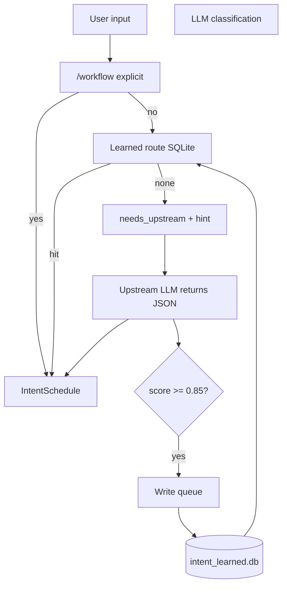

# Intent interpretation & intent receiver

> Japanese version: [INTENT-RECEIVER.ja.md](INTENT-RECEIVER.ja.md)

§0 **A resident intent receiver takes the user input, the intent interpreter selects the workflow, and downstream (MCP / Kilo / Cursor) launches `@.kilo/commands/<workflow>.md`.**

**Public guide** (user-facing, procedure-first): [INTENT-ROUTING.md](../INTENT-ROUTING.md)

---

## 1. Relationship with other projects

**wawoo-skills is a generic kit (self-contained)**. It is a **separate repository** from an LLM API gateway (e.g. co.taro.bz).

| Aspect | wawoo-skills |
|------|----------------|
| Hot path | Not on it (only the MCP / IDE entry) |
| Decision | The in-conversation model's **workflow fitness JSON** (no dedicated LLM API) |
| Learning | `intent_learned_store.py` (SQLite, async) |
| Route | **L0 explicit/command → L1 learned → L2 score → L3 is the host agent** |

When another product uses the same intent stack, the only integration is optional: **point MCP via `WAWOO_SKILLS_ROOT`** (the kit has no API dependency).

---

## 2. Flow



---

## 3. Components

| Path | Role |
|---|---|
| `mcp/intent_catalog.py` | Workflow descriptions, MCP allow-set |
| `mcp/intent_commands.py` | L0 slash via `.kilo/commands` |
| `mcp/intent_interpreter.py` | Orchestration (L0–L2) |
| `mcp/intent_learned_store.py` | Learned triggers / safe regex |
| `mcp/intent_upstream.py` | Shortest JSON contract for the upstream LLM |
| `mcp/intent_learn_queue.py` | Async queue for SQLite writes |
| `mcp/intent_receiver.py` | Resident receiver over NDJSON / Unix socket |
| `mcp/intent_client.py` | Sends to `WAWOO_INTENT_SOCKET` |
| `mcp/intent_session.py` | MCP tool gate after a schedule is fixed (B3) |
| `mcp/intent_delegation.py` | L3 `delegate_subtask` payload |
| `scripts/task-router.py` | CLI wrapper |
| MCP `interpret_intent` / `route_task` | Tool calls (by default, interpreted locally inside MCP) |

---

## 4. Steps

| Stage | Content |
|---|---|
| 1 | Start resident: `python3 mcp/intent_receiver.py --socket /tmp/wawoo-intent.sock` |
| 2 | Set `WAWOO_INTENT_SOCKET=/tmp/wawoo-intent.sock` on the MCP client |
| 3 | The agent calls `interpret_intent` first (only when resident, `via_receiver: true`) |
| 4 | The returned `schedule` enables the MCP **tool gate** (`mcp_tools_allow`) |
| 5 | `workflow_get` → run the steps. Parallel subtasks: `delegate_subtask` (L3) |
| 6 | At the end, release the gate with `workflow_clear` |

stdio only: `python3 mcp/intent_receiver.py` (one JSON per line).

---

## 5. Protocol (NDJSON)

**Request**

```json
{"id":"req-1","text":"I want to fix a bug","meta":{}}
```

**Response**

```json
{"id":"req-1","ok":true,"schedule":{"workflow":"delivery-lite","workflow_slash":"/delivery-lite","agent":"implementer",...}}
```

**Health**

```json
{"op":"ping"}
```

---

## 6. Environment variables

| Variable | Default | Description |
|---|---|---|
| `WAWOO_INTENT_LEARN_DB` | `data/intent_learned.db` | Learned routes (optional override) |
| `WAWOO_INTENT_SOCKET` | empty | Resident receiver (optional) |
| `WAWOO_SKILLS_ROOT` | Repository root | Same as the existing MCP |

No LLM API key is needed for intent (the decision is made by the Cursor/Kilo upstream model).

**Thinking mode**: `upstream_prompt` states that extended thinking / CoT / code blocks are prohibited. On an intent-classification turn, do not write user-facing prose either.

---

## 7. Gates

| id | Condition | Result |
|---|---|---|
| G-1 | Empty input | `delivery-lite`, confidence low |
| G-2 | Explicit `/workflow` | Prefer that workflow (explicit_override) |
| G-3 | `via_receiver` but the receiver is not running | Error (socket connection failure) |

---

## 8. Acceptance

| Expectation | Pass |
|---|---|
| `python3 scripts/e2e_flows.py` is green | All asserts succeed |
| MCP `interpret_intent` returns JSON | `internal/tests/test_server.py` (non-public) |
| An explicit `/research` routes to research | unit tests (`internal/tests/`) |

---

## 9. Downstream readers

| Reader | Use |
|---|---|
| Agent / IDE | MCP tools |
| Shell | `task-router.py` |
| Operations | Keep `intent_receiver` resident via systemd |

---

## 10. Principle self-check

| Principle | Trace |
|---|---|
| PDCA | This document §8 acceptance |
| Self-iteration | `scripts/e2e_flows.py` |
| Agility | Vocabulary is consolidated into the learned DB (seeded) + upstream, after removing the static trigger table |
| Team collaboration | Receiver = operations, interpreter = development |
| Clear information flow | `workflow_slash` matches the commands stem |

---

## 11. Change history

| Date | Content |
|---|---|
| 2026-10-26 | First version (intent interpreter, resident receiver, MCP integration) |
| 2026-10-26 | LLM-driven decision, high-score learned store (removed the static keyword table) |
| 2026-10-26 | Audit reflection: route_task/needs_scoring, learn default off, promote validation |
| 2026-10-26 | Catalog L0–L2, B3 gate, L3 delegate, public `INTENT-ROUTING.md` |
| 2026-10-28 | English primary + `INTENT-RECEIVER.ja.md`; tests referenced under non-public `internal/tests/` |
