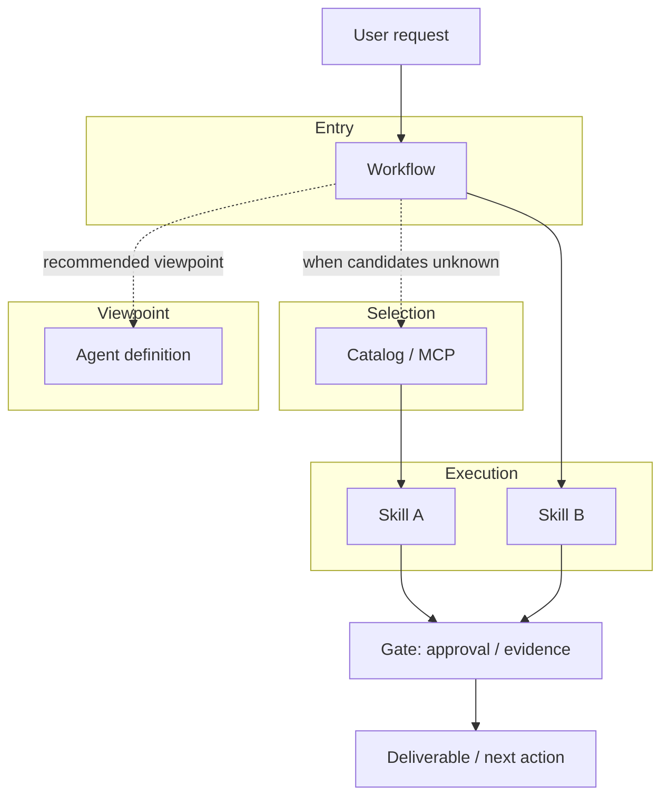

# Methodology — Skill / Agent / Workflow

> Japanese version: [METHODOLOGY.ja.md](METHODOLOGY.ja.md)

> **§0 in one sentence**: so agents don't skip steps and roles, solve the problem in three layers — **the workflow owns the process, skills supply the steps, and agent definitions fix the viewpoint**.

Theory of the **timeline, gates, and delivery lifecycle**: [PROCESS-PHILOSOPHY.md](./PROCESS-PHILOSOPHY.md).

## 1. The problem it solves

| Symptom | Cause (structure) | This methodology's answer |
|---|---|---|
| Steps differ every time for the same request | The process is left to the model's improvisation | A **workflow** owns the entry and the skill chain |
| A skill exists but is never read | Full-text loading and an oversized catalog turn selection into prose | **Catalog / MCP** selects candidates → open only what you need |
| Review and legal are skipped | The done definition and gates are not in the contract | Embed **gates** (approval, evidence, observed failure) in the workflow |
| "Whose viewpoint was applied?" drifts | The role drifts per conversation | **Agent definitions** reference the viewpoint by name |

The goal is not to bind the agent with tricks but to provide **reproducible orchestration**.

### 1.1 Limits of the effect (to avoid misunderstanding)

This kit raises the probability of "read it, follow it in order" through **norms** (contract, workflow, MCP, rules). It does **not enforce at runtime** (e.g. stopping at the OS level if a skill was not run). The effect depends on **making the process explicit + progressive disclosure + stating gates in words**. Auditing is done **after the fact** via conversation logs, PRs, `change-readiness`, etc.

## 2. The three components

### 2.1 Workflow (command)

- **Definition**: the **owner of the process** for delivering a deliverable or decision (`.kilo/commands/<name>.md`).
- **Holds**: the step order, the chain of skills to call, the output shape, gates, the recommended `agent:` (the driving viewpoint).
- **Does not hold**: the detailed steps of each step (that is delegated to skills).
- **Metaphor**: a recipe's "process sheet". It says which technique is used at which point, but the technique's textbook lives separately.

**Design principle (workflow-driven)**: assuming the agent may skip skills on its own, **the workflow calls skills explicitly** (same as the commands README).

### 2.2 Skill

- **Definition**: the **executable spec** of one capability/procedure (`.kilo/skills/<name>/SKILL.md`).
- **Holds**: when to use it (description), the steps, checklists, references (`references/`), and gate wording if needed.
- **Does not hold**: the end-to-end delivery process (that is the workflow).
- **Metaphor**: a manual for a single technique. Connecting several is the workflow's job.

**Design principle (progressive disclosure)**: keep the entry `SKILL.md` small; put long text in `references/`. The catalog is one-line descriptions only (`CAPABILITIES.md` / MCP).

### 2.3 Agent

- **Definition**: a named label for a **viewpoint, responsibility, and mode** (`.kilo/agents/<name>.md`). It is not a resident separate persona process.
- **Holds**: what this role prioritizes and prohibits (review axes, facilitation, the legal-check stance, etc.).
- **Does not hold**: step-by-step implementation steps (skill) or the whole flow (workflow).
- **Metaphor**: a role card — the SSOT for declaring "from now I read from the code-reviewer viewpoint".

**Using it in Cursor, etc.**: since native switching is unavailable, read `@.kilo/agents/<role>.md` and **apply that viewpoint**.

## 3. Relationships (who calls whom)

| Arrow | Meaning |
|---|---|
| Request → Workflow | **In principle** enter via some command (when unsure, `ask-matt` or the catalog; a one-off skill leaves a reason for skipping) |
| Workflow → skill | Open only the skills listed in the body, **as needed** |
| Workflow → catalog | **Unnecessary** when the body already names the skill. Only when names are unknown or too many |
| Workflow → agent | Reference as the **viewpoint** for facilitation/review (not a substitute for steps) |
| skill → gate | Do not skip the stop conditions written in the skill / workflow |

## 4. Invocation protocol (WARO)

A summary of the operational contract. Details: [AGENTS.md](../AGENTS.md).

| Stage | Name | Action |
|---|---|---|
| **W** | Workflow | Choose the entry command and check the output schema |
| **A** | Acquire | Narrow candidates via `capabilities` / `skill_search` (do not read everything) |
| **R** | Read skill | Open only the `SKILL.md` the workflow names |
| **O** | Observe & Output | Pass the gates and produce the deliverable with evidence |

## 5. Ceremony levels (L0–L3)

> **Note:** these `L0–L3` are **ceremony levels** — how much process a task carries. The **route layers** use the same letters in `INTENT-ROUTING.md` — a different axis (how a request is routed). Same letters, different meanings; always say which axis you mean.

Manage by a **default entry + file state machine**, not by **repeating conversations**. The user just issues the request; the agent reads and updates the SSOT.

| Level | When | Entry workflow | Progress SSOT | Do not |
|--------|------|---------------|-------------------|--------------|
| **L0** | Single spot, clear scope | (skippable) only `implement` | None (`git diff` is the evidence) | Plan files, PDCA, sprints |
| **L1** | Normal features, multiple steps | **`/delivery-lite`** | **`docs/plans/ACTIVE.md`** | Re-explaining steps each time, a second progress table |
| **L2** | Multiple tasks, need sync | `/sprint-plan`, `/status-report` | **issue tracker** (`to-tickets`) + `plan-md` if needed | Double-managing issues and a separate spreadsheet-style progress |
| **L3** | Process improvement, recurring incidents | `/self-improve`, `pdca-cycle` | `retro` record, `memory`, procedure updates | PDCA for every small feature request |

**State machine (L1)**: `todo` → `doing` (one at a time) → `done` (evidence required). Details: `docs/plans/README.md`.

**PDCA / Agile**: use at L2 boundaries (sprints) or L3. Do not put the whole PDCA on every L1 task.

### 5.1 Deliverable type → entry workflow → SSOT

The ceremony (L0–L3) is common. Only the **entry and the SSOT file** change per deliverable (do not put everything on `/delivery-lite`).

| Deliverable | Typical L | Entry workflow | Progress SSOT | Deliverable SSOT |
|--------|--------|---------------|-----------|-----------|
| Code feature | L1 | `/delivery-lite` | `docs/plans/ACTIVE.md` | Repository, test logs |
| Web / UI | L1 | `/ui-delivery` | `ACTIVE.md` + `DESIGN.md` | Screenshots, audit |
| Research / decision | L1 | `/research` | `ACTIVE.md` | `docs/` research MD |
| Market / business plan | L1 | `/market-plan` | `ACTIVE.md` + `plan-md` | Plan MD |
| Long-form / books / reports | L1 | `/content-delivery-lite` | `docs/plans/CONTENT.md` | Draft path |
| Multiple-task sync | L2 | `/sprint-plan` | issue / `BACKLOG*.md` | — |
| Process improvement | L3 | `/self-improve` | `RETRO*.md` + `memory` | — |

**Per-tool entry**: Kilo uses `/name`; Cursor uses `@.kilo/commands/<name>.md` (no slash). Parity check: `python3 scripts/cli_adapters_mock.py`.

## 6. When to add what (design decision)

| What you want | Layer to add | Example |
|---|---|---|
| A new single technique (how to write tests, a legal checklist) | **Skill** | `tdd`, `compliance-legal` |
| A new viewpoint (the security reviewer's eye) | **Agent** | `security-reviewer` |
| A new delivery path (the standard route for UI changes) | **Workflow** | `/ui-delivery` |
| The default route for a single request (progress SSOT) | **Workflow** | `/delivery-lite` + `docs/plans/ACTIVE.md` |
| Too many candidates to choose | **Catalog / MCP** | Regenerate `gen_capabilities.py`, improve descriptions |
| Ambiguous request, workflow undecided | **Intent routing (MCP)** | `interpret_intent` ([INTENT-ROUTING.md](./INTENT-ROUTING.md)) |
| External prerequisite (no issue tracker) | **Readiness** | Keep it off the standard flow in `scripts/readiness.json` |

**Anti-patterns**

- Putting the whole workflow into one giant skill → never read. Separate workflow and skill.
- Writing only implementation steps in an agent → the viewpoint is not reusable. Steps go in skills.
- Pasting 57 skills into the prompt every time → context exhaustion. Use the catalog + progressive disclosure.

## 7. Gates (where quality stops)

Use as the common **done definition** for every workflow. Symbols correspond to [PROCESS-PHILOSOPHY.md](./PROCESS-PHILOSOPHY.md) §4.

| Gate | Symbol | Meaning |
|---|---|---|
| **Approval** | Gₐ | Humans decide destructive changes, production, deletions, external transmission, contracts |
| **Evidence** | Gₑ | Commands, diffs, logs. Separate inference from measurement |
| **Observed failure** | Gₒ | Fix based on failures that happened (not imagined refactors only) |

Legal/privacy skills do **not delegate the judgment to the agent** (checklist and evidence only).

## 8. Context budget (a constraint of the methodology)

The amount of information handed to the model is part of the design.

- The contract, catalog, workflow, and skill all have **limits** ([AGENTS.md](../AGENTS.md) §5).
- **One SSOT**: do not write the same procedure in both the README and a skill. The skill is authoritative.
- Move large skills into `references/` and read only the entry first.

## 9. Tool mapping

| Environment | Workflow | Skill | Agent | Selection |
|---|---|---|---|---|
| Kilo | `/name` | auto / explicit reference | recommended `agent:` | MCP, `.kilo/`, `interpret_intent` (optional) |
| Cursor | `@commands/...` | `@skills/.../SKILL.md` | `@agents/...` | MCP, `@CAPABILITIES.md`, `interpret_intent` (optional) |

Intent-routing steps and JSON contract: [INTENT-ROUTING.md](./INTENT-ROUTING.md). This is distinct from ceremony levels L0–L3 (§5): it refers to the **route layer** L0–L2 plus delegation L3.

## 10. Acceptance (is the methodology working)

| id | Check | Pass |
|---|---|---|
| M1 | A standard task rides on some workflow (or a stated reason to skip) | The entry can be named in the conversation log |
| M2 | The skills used are explainable by the workflow or catalog selection | A path remains |
| M3 | When a gate applies, there is a stop or an approval request | No direct production hits |
| M4 | The steps for the same task type are reproducible | The same chain on the 2nd attempt onward |

## 11. Related documents

| Document | Purpose |
|---|---|
| [USAGE.md](./USAGE.md) | Per-tool operations |
| [AGENTS.md](../AGENTS.md) | Agent contract (required) |
| [README.md](../README.md) | Overview, contents |
| [PROCESS-PHILOSOPHY.md](./PROCESS-PHILOSOPHY.md) | Process philosophy (lifecycle, gates, traceability) |
| `.kilo/commands/README.md` | Workflow list |

---

**Update**: methodology changes must not contradict the invocation protocol in `AGENTS.md`. On conflict, treat **AGENTS.md as authoritative** and fix this document.
