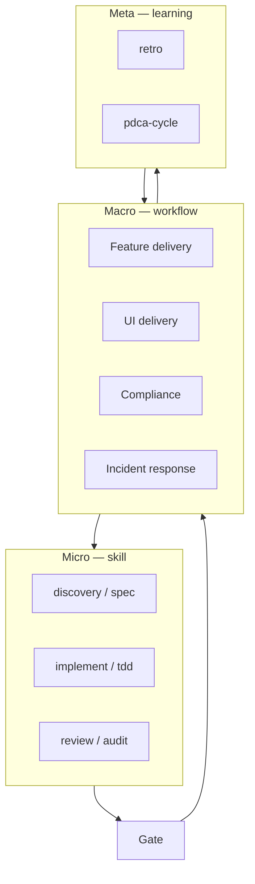

# Process philosophy — treating the process of delivery as theory

> Japanese version: [PROCESS-PHILOSOPHY.ja.md](PROCESS-PHILOSOPHY.ja.md)

> **§0 in one sentence**: do not reduce software work to "the moment of writing code" — design the process **intent → decision → implementation → verification → approval → learning** as an explicit owned artifact, not left to the agent's improvisation.

This document complements [METHODOLOGY.md](./METHODOLOGY.md) (the **structure** of Skill / Agent / Workflow) with a theory of **time, quality, and epistemology**. The operational contract is [AGENTS.md](../AGENTS.md).

---

## 1. Stance: the process is part of the deliverable

| Common misconception | The process-philosophy stance |
|---|---|
| A prompt is enough | A prompt is the **entry**, not the definition of delivery |
| Done when implementation ends | **Verification, gates, and approval** are part of the process |
| Failures are patched ad hoc | Record the **observed failure** and feed it back into the environment (steps, checks) |
| A smart agent needs no order | Smartness creates **variance**. Order exists for **reproducibility** |

**Definition (process)**: the **ordered transformation** that turns an intent into an agreed deliverable, together with the **done criteria** of each stage.

---

## 2. Macro, micro, meta (+ viewpoint)

A model that adds meta-learning on a **time axis** to METHODOLOGY.md's three layers (workflow / skill / agent). An agent is not a resident process but a **viewpoint** for review and facilitation (the "viewpoint" row in the §2 table).



| Layer | Question | Typical location |
|---|---|---|
| **Macro** | Which path delivers what | `.kilo/commands` (16 workflows) |
| **Micro** | How to work this stage | `.kilo/skills` |
| **Viewpoint** | Whose eyes to use | `.kilo/agents` (used with a command's `agent:`) |
| **Meta** | How to improve the next process | `retro`, `pdca-cycle`, `memory` |

**Principle**: the macro **calls** the micro. Lining up only micro skills does not make a process (the workflow-driven principle of METHODOLOGY.md).

---

## 3. Delivery lifecycle (general form)

A **product-independent abstract lifecycle** of the process philosophy.

| Stage | Name | Purpose | Typical skills (examples) |
|---|---|---|---|
| **D0** | Fix the intent | For whom; what change means success | `product-discovery`, `research` |
| **D1** | Record the decision | Keep hard-to-reverse choices | `architecture-decision`, `to-spec` |
| **D2** | Make it executable | Reduce to tickets and acceptance criteria | `to-tickets`, `plan-md` |
| **D3** | Build | Produce code / documents | `implement`, `implement-spec`, `tdd` |
| **D4** | Verify | Show it is not broken | `test-engineering`, `change-readiness` |
| **D5** | Multi-faceted review | Quality, UI, safety viewpoints | `code-review`, `accessibility-audit`, `security-review` |
| **D6** | Approve and release | Production and publishing are human decisions | `release-readiness`, `compliance-legal` |
| **D7** | Learn | Update the environment and steps | `retro`, `pdca-cycle` |

**SSOT**: the skill chain of each stage is authoritative in **the `.kilo/commands/<name>.md` body**. The list in `.kilo/commands/README.md` is a summary and **may diverge from the body** (e.g. `/feature-delivery`'s body runs `product-discovery`→`architecture-decision`→implementation delegation→`test-engineering`→`change-readiness`; the table's `to-spec`→`implement` chain is a summary of a different lineage).

`/feature-delivery` mapped to D stages (body-based):

| D stage | How the body handles it |
|---|---|
| D0 | `product-discovery` |
| D1 | `architecture-decision` (when applicable) |
| D3 | Implementation delegation + `engineering-quality` |
| D4 | `test-engineering` |
| D5 | `web-experience-design`, `accessibility-audit`, `security-review` depending on UI/boundaries |
| D6 | `change-readiness`, approval gate (no push/production) |
| D2, D7 | Not explicit in the body (ticketing and retro are separate workflows, or leave a reason when skipped) |

UI, research, incident, and compliance have separate workflows that change the D0 entry.

**Omission rule**: when skipping a stage, leave **a reason and evidence** ("small change, so D1 skipped" → a one-line scope and a diff).

---

## 4. Gate theory (types of stop)

A gate is not an annoyance but a **transition condition in the process state machine**.

| Type | Symbol | Meaning | Example |
|---|---|---|---|
| **Gₐ** | Approval | Stop before an irreversible operation a human owns | Production, deletion, contracts, external transmission |
| **Gₑ** | Evidence | Match claims to logs, diffs, command output | Test results, repro steps |
| **Gₒ** | Observation | Fix based on failures that actually happened | Forbid refactors on inference alone |

**Theorem (practical)**: a "done" claim is valid only **up to the stage that satisfies Gₑ**. If Gₐ applies, it is still **incomplete** even when satisfied.

The legal/privacy process (`/compliance-review`) is an **aggregation of Gₐ**: the agent goes as far as checklists and evidence; **humans judge**.

---

## 5. Traceability (the chain of intent)

The heart of the process philosophy is being able to trace intent in **one chain**.

```text
intent → discovery/scope → spec/ADR → ticket → change → review → release record → retro
```

| Link | What happens when it is broken |
|---|---|
| intent ↔ spec | Scope creep, unacceptable |
| spec ↔ ticket | The implementation is something else, unreviewable |
| change ↔ evidence | "It ran" is unverifiable |
| release ↔ learning | The same incident recurs |

`to-spec` / `to-tickets` are the chain's **intermediate representation**. When no issue tracker is configured, keep them off the standard process ([readiness.json](../scripts/readiness.json)) — a design that **does not silently use** a broken path.

---

## 6. Epistemology: evidence, inference, unverified

Classify process statements into three values (consistent with [AGENTS.md](../AGENTS.md)).

| Category | Definition | Process treatment |
|---|---|---|
| **Evidence** | A third party can re-confirm by the same steps | Basis for done / review pass |
| **Inference** | Plausible but unconfirmed | State as a hypothesis and verify at D4 |
| **Unverified** | Not yet seen | Do not use for a release decision |

**Observed failure**: work the fix **backward from a reproducible failure**. Imagined bug fixes pollute the process.

---

## 7. Environment iteration vs product iteration

Theorizing the idea behind `retro`.

| Target | What changes | Example |
|---|---|---|
| **Product iteration** | Code, config, data | Bug fixes, feature additions |
| **Environment iteration** | The **surroundings** the agent works in | Checklists, rules, skill wording, CI |

The process philosophy allows both but **does not mix them in the same conversation**. Retro is a meta-process (D7) that "makes the next process easier".

`pdca-cycle` is for **small hypothesis experiments** on environment, process, or quality. Standardize in Act, or fold into the next workflow.

---

## 8. Standard and exceptional paths

The 16 workflows are a **reference architecture** (not mandatory, but the SSOT when unsure).

| Path type | Representative | Process meaning |
|---|---|---|
| **Delivery** | `/feature-delivery`, `/ui-delivery` | Product changes D0–D6 |
| **Decision** | `/research`, `/market-plan` | Mainly D0–D2 (research, planning). Just before a D6 release, combine with `/release-review` |
| **Gate aggregation** | `/compliance-review`, `/release-review` | Bundling Gₐ and Gₑ |
| **Operations** | `/incident-response` | D4–D7 under time pressure |
| **Lightweight delivery** | `/delivery-lite` | L1. Sync D2–D4 to a file state machine via `docs/plans/ACTIVE.md` |
| **Planning / reporting** | `/sprint-plan`, `/status-report` | Chain synchronization |
| **Meta** | `/self-review`, `/self-improve` | Self-correction of quality and process |

**Router** `ask-matt` is an **index** of the standard paths (outside the process, but used for entry selection).

---

## 9. WARO and D stages (do not conflate)

> **Note (same-letters trap):** `L0–L3` has two meanings across the docs — **ceremony levels** (`METHODOLOGY.md` §5) vs **route layers** (`INTENT-ROUTING.md` §1). Confirm which axis is meant before using the letters.

**WARO** ([METHODOLOGY.md](./METHODOLOGY.md) §4) is the **operation order within a single request**. **D0–D7** are **abstract stages of the delivery lifecycle**. Do not use the same letter (especially A) for a different concept.

### 9.1 WARO (operation protocol)

| Stage | Action | Note |
|---|---|---|
| **W** | Choose the command and check the output shape | The standard paths of §8 |
| **A** | Narrow candidates via `capabilities` / `skill_search` | **Different from D0 discovery**. If the workflow already names the skill, A can be skipped |
| **R** | Open the specified `SKILL.md` | Most of D3–D5 is here |
| **O** | Produce the deliverable satisfying Gₑ and Gₐ | The condition for a done claim |

### 9.2 Rough mapping to D stages

| D stage | Mainly involved WARO |
|---|---|
| D0–D2 | W (path) + R (discovery/spec skills). A only when the skill name is unknown |
| D3–D5 | R + O (evidence) |
| D6 | O (Gₐ approval) |
| D7 | Another session's W (`/self-improve`, etc.) + R (`retro`) |

---

## 10. Implications for design (for kit authors)

1. **A new process need** → first decide whether it is a new workflow or a stage added to an existing workflow.
2. **A new single technique** → a skill. Insert it into an existing workflow's chain **by name**.
3. **A gate** → write it in the workflow body with an id ("no production without approval", etc.).
4. **Readiness** → keep a premise under which the chain cannot hold off the standard paths.

---

## 11. Acceptance (is the process philosophy alive)

| id | Check | Pass |
|---|---|---|
| P1 | The workflow (or a reason to skip) matching the change can be stated | One line in a log or PR |
| P2 | The done claim carries evidence | Gₑ |
| P3 | There is approval before an irreversible operation | Gₐ |
| P4 | The retro is fed back into the environment or steps | D7 is not empty (`docs/memory/` append, `memory` skill / MCP `memory_save`; template `docs/memory/TEMPLATE.md`) |

---

## 12. Related

| Document | Content |
|---|---|
| [METHODOLOGY.md](./METHODOLOGY.md) | The three layers Skill/Agent/Workflow, WARO |
| [USAGE.md](./USAGE.md) | Per-tool operations |
| `.kilo/commands/README.md` | Workflow list and skill chains |

**Authoritative precedence**: the required process behavior is in **AGENTS.md** and each **command** body. This document is their **theoretical arrangement**.

**Known repository issue** (outside the theory but noted): some command bodies and the skill chains in `commands/README.md` do not match. When fixing, make **the body authoritative** and update the table to follow.
